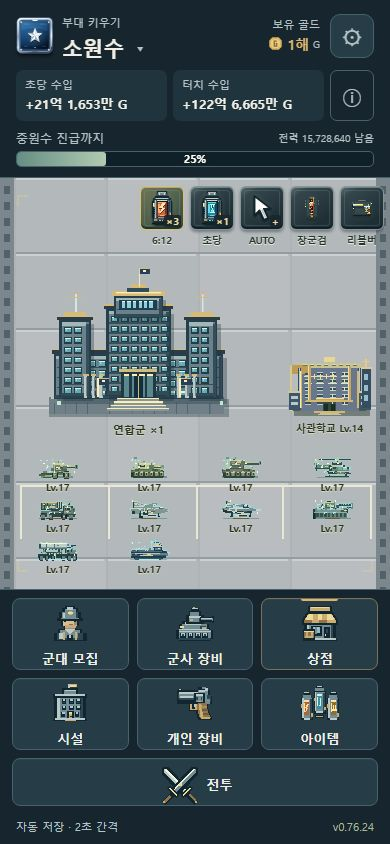
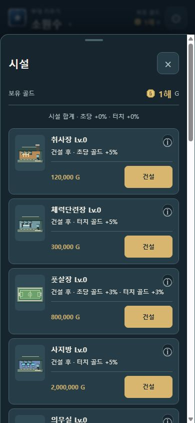
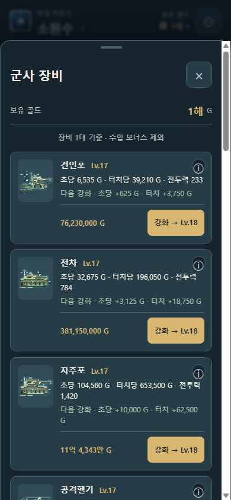
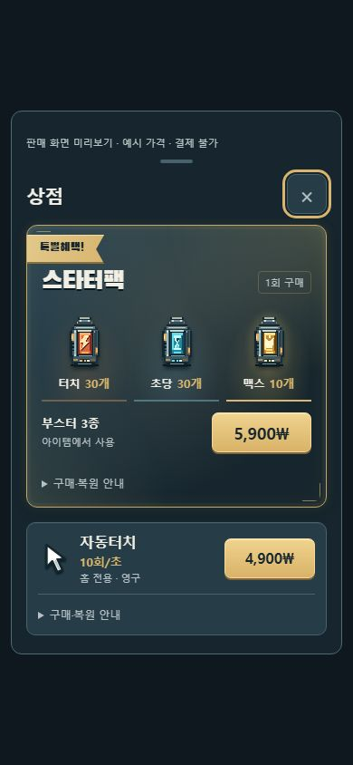

# 공통 UI 개선 · 0.76.24

2026-10-15. 사용자가 디자인 평가 후 실제 적용을 승인했다. 색/글꼴 → 홈/메뉴 → 시설·장비 → 상점 순서로 적용한다. 게임 규칙·가격·저장·서버·정책 번호는 이번 범위에서 변경하지 않는다.

## 공통 규칙

`src/ui-theme.css`가 화면별 기존 CSS 뒤, 터치 크기 보호 CSS 앞에서 공통 역할을 정의한다. 전면 재작성 대신 기존 화면과 동작을 유지하면서 공통 표면·글자·버튼 규칙을 적용했다.

| 역할 | 값 |
| --- | --- |
| 바탕 / 표면 / 높은 표면 | #17262e / #263c47 / #304a56 |
| 본문 / 설명 | #f1efe5 / #b6c2c5 |
| 강조 / 경계 / 성장 안내 | #d8b66f / #49616b / #a8c5ad |
| 본문 글꼴 | 기존 Malgun Gothic / Apple SD Gothic Neo / system-ui |
| 광고 제목 | 기존 로컬 Black Han Sans, 짧은 스타터팩 제목만 |

지도 영토·군사 그림·전투 신호의 색은 별도 의미를 유지한다. 신규 외부 폰트/이미지/SDK/통신은 추가하지 않았다. 메뉴 리볼버는 직접 작성한 SVG 도형이다. 기존 Black Han Sans OFL 고지와 파일은 유지한다.

## 바꾼 화면

- 홈: 초당/터치 수입을 두 칸으로 구분. 합산 효과는 기본 닫힌 네이티브 details로 확인하며 열린 상태도 연병장 높이를 바꾸지 않는다. 기존 동적 업데이트 ID와 수입 계산을 그대로 사용한다.
- 메뉴: 7개 이름/순서/동작 유지. 아이콘44px, 짧은 화면36px. 6개 메뉴72px, 짧은 화면64px. 전투는 최소48/46px. 개인 장비는 리볼버로 구별하며 빈 잠금 안내가 만드는 간격을 제거한다. 잠긴 전투 안내는 한 줄 배치 범위 안에서 자연 줄바꿈한다.
- 소모품: 우측 그림 아래 짧은 이름, 사용 중에는 같은 위치에 남은 시간. 장군검/리볼버 타이머의 투명 배경을 유지한다.
- 모집: 공통 색·서체와2열 카드로 작은 수치의 공간을 확보. 모집량/학교/해금 조건은 그대로다.
- 시설: ‘미보유 · 효과 없음’ 대신 건설 후 효과, 보유하면 현재/강화 후 효과. 잠금 조건과 골드 부족은 유지한다.
- 군사 장비: 현재 기본 능력과 다음 강화의 기본 골드 증가량. 공통 equipmentStats와 subtractMoney로 계산하며 단계별 문자열을 캐시한다. 장비1대/수입 보너스 제외 기준을 표시한다.
- 개인 장비: 이름/레벨과 효과를 분리하고 보유/미획득을 현재/획득 후로 구분. 반복 지급 설명은 상세에서 확인할 수 있다.
- 목록의 가격과44px 행동 버튼은 같은 행에 묶고 상세 버튼은 별도44px 영역을 유지한다. 목록 전체 재생성 없이 텍스트만 갱신하는 기존 구조를 보존한다.
- 상점: 스타터팩 수량을30개/30개/10개로 표시. 혜택 리본과4.2초1회 장식 유지. 자동터치78px 주요 행에‘10회/초’,‘홈 전용 · 영구’를 상시 표시. 가격 버튼과 접이식 구매·복원 안내는 유지한다. 자동터치 팝업 장식도4.8초1회 후 종료, reduced-motion 대응 유지.

## 근거와 한계

- 피츠: 버튼 실제 영역과 이동 거리. 주요 행동44px을 유지하고 도움말도44px. https://www.yorku.ca/mack/hci1992.html
- 제이콥: 익숙한 이름/위치와 닫기/구매 상태 일관성. 수학적 법칙이 아닌 설계 경험칙. https://jakobnielsenphd.substack.com/p/jakobs-law
- 근접성: 효과/가격/행동을 관계가 보이도록 묶음. https://www.yorku.ca/pclassic/Wertheimer/Forms/forms.htm
- 폰 레스토프: 조용한 기본 화면에서 스타터팩만 구별. 기억 연구가 구매율 보장은 아님. https://doi.org/10.1037/0278-7393.27.6.1359

앞선 평가에서 열람한 연구의 적용 판단이다. 실제 사용자 구매율·잔존율·실기기 편안함 개선을 측정한 것은 아니다. 연구 범위와 게임 벤치마크는 대화의 평가 및 HOME_MENU_UX_REVIEW.md 참고.

## 화면 증빙과 검증 경계

가짜 진행 기록을 새 로컬4225에만 준비했다. 기존 게임 저장 origin을 초기화하거나 덮어쓰지 않았다. 상점 판매 미리보기는 예시 가격만 표시하고 네이티브 구매·지급·저장 핸들러를 연결하지 않는다.

| 홈 | 시설 |
| --- | --- |
|  |  |
| 군사 장비 | 상점 판매 미리보기 |
|  |  |

- Chrome390×844 홈 및320×640 홈/시설/군사·개인장비/모집의 가로 넘침 없음.320px처럼 낮은 화면에서는 연병장 그림이 작게 압축되는 기존 배치 특성이 남아 있다. 실제 S9+의 글자 크기/한손 조작은 미확인이다.
- 320/390px 상점 판매 미리보기에서 자동터치 주요 행78px, 구매44px 이상, 도움말44px, 가로 넘침 없음. 구매 복원 안내 펼치기 확인.
- 가짜 기록의 취사장 건설 후 현재5%→다음6%, 다음 가격/포커스 유지 확인. 실제 결제/광고/서버 호출은 하지 않았다.
- 첫 전체818개 중815개 통과, 실패3개는 삭제한 반복 보상 문구의 옛 기대값. 보유/보상 규칙 변경 없이 카드 보유상태·레벨·현재 효과, 상세의 원래 진급 보상 설명을 각각 검사하도록 갱신. 관련48개 통과. 최종 전체 결과는 검증결과.md.

## 되돌림·정책

이번 UI 커밋을 되돌리면 이전 화면으로 복구된다. 저장 키/형식42와 migration, 큰 금액 계산, Play 구매 권리/복원/스타터 지급 조건은 유지된다. 서버/main/콘솔/AAB는 변경하지 않았다. 방침12·약관9 불변.

개인정보 정책 영향 없음. 이전 출시 앱은 자동터치5회이므로 새10회 앱을 배포할 때 Play 상품 설명도 동기화해야 한다. 이번 작업은 앱 안 문구와 게시 준비 문서까지이며 공개 상품 설명은 변경하지 않았다.
