# 부대 키우기 홍보물 · 동람코 홈페이지 작업 기록

2026-10-20 ~ 10-22 작업. 게임 코드·저장 구조·버전은 바꾸지 않았고, 이 폴더에 홍보물과 홈페이지 원본·기록만 추가했다.

## 요약

| 항목 | 결과 | 위치 |
| --- | --- | --- |
| 게임 화면 캡처 | 0.76.55(브랜치 `claude/gracious-wright-kk0iqc`, 10-20) 실제 실행 화면 15장, 1080×2340 | `promo/screens/` |
| 홍보물 | 스토어 스크린샷 7, 피처 그래픽 1, SNS 정사각 3, 스토리 1 | `promo/out/` |
| 홍보물 원본 | 한 HTML 파일에서 모든 홍보물을 그리고 PNG로 저장 | `promo/creatives.html`, `promo/render.mjs` |
| 캡처 도구 | 테스트용 저장 데이터로 게임을 실행해 장면을 찍는 스크립트 | `capture/` |
| 브랜드 | 로고, 로고 화살 엠블럼 SVG, 공유 미리보기 이미지 | `brand/` |
| 홈페이지 | dongramco.com에 배포된 원본과 화면 캡처 | `homepage/site/`, `homepage/screens/` |

## 홍보물

캠페인 문구는 게임 코드 기준 사실만 사용했다.

| 역할 | 문구 | 근거 |
| --- | --- | --- |
| 대표 슬로건 | 이등병에서, 은하 원수까지. | 계급 35단계(`src/ranks.js`) |
| 행동 문구 | 터치로 모집하고, 진급하고, 점령하라. | 터치 → 모집 → 진급 → 전투 |
| 숫자 훅 | +1 G → 8,945경 G | 첫 터치 수입, 은하 준장 캡처 화면의 보유 골드 |
| 신뢰 포인트 | 35 계급 · 200 전장 · 장비 17종 · 시설 19종 | 0.76.55 공통 정의 |

색은 회사 색(주황 `#ff681e` · 검정 `#151515` · 흰색), 제목 글꼴은 게임에 이미 포함된 Black Han Sans(OFL)를 썼다.

<a href="promo/out/store-1.png">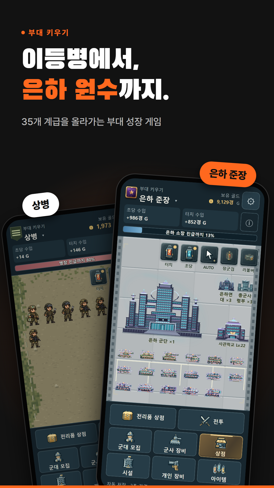</a>
<a href="promo/out/store-2.png">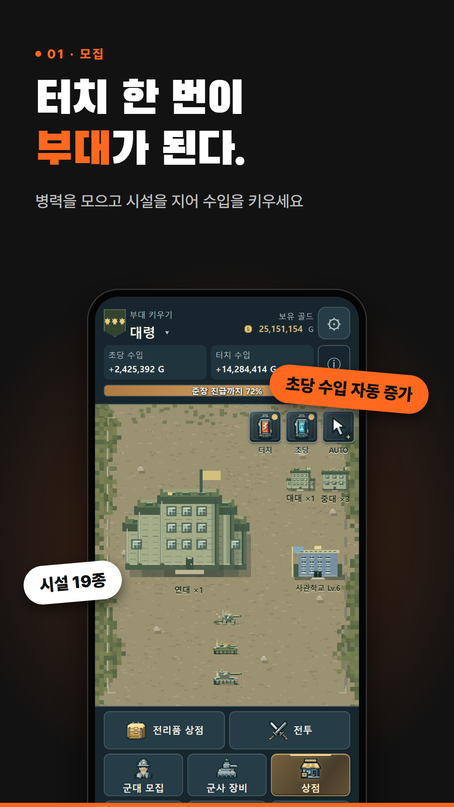</a>
<a href="promo/out/store-3.png">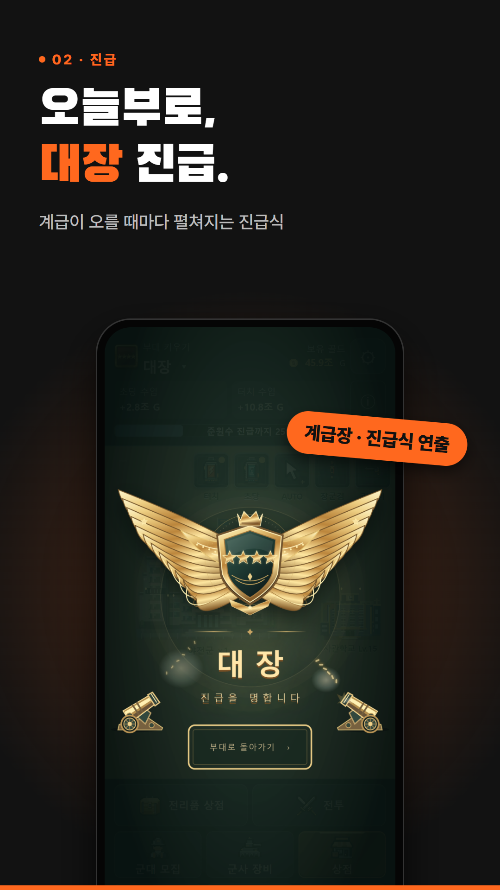</a>
<a href="promo/out/store-4.png">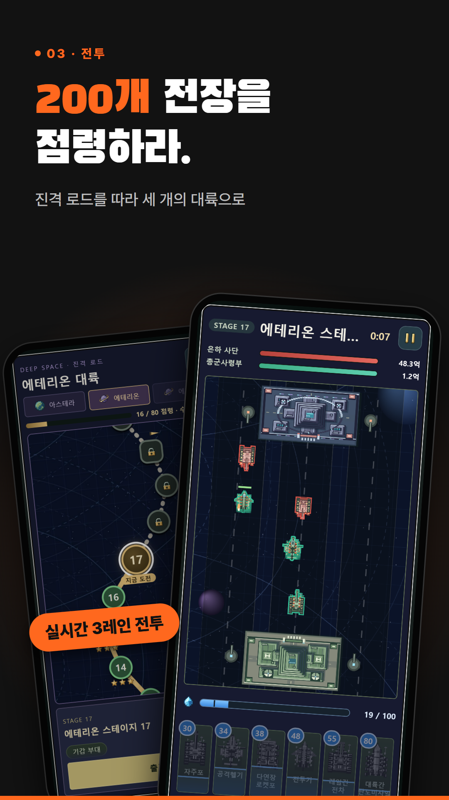</a>
<a href="promo/out/store-5.png">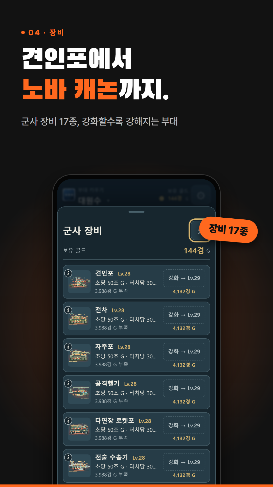</a>
<a href="promo/out/store-6.png">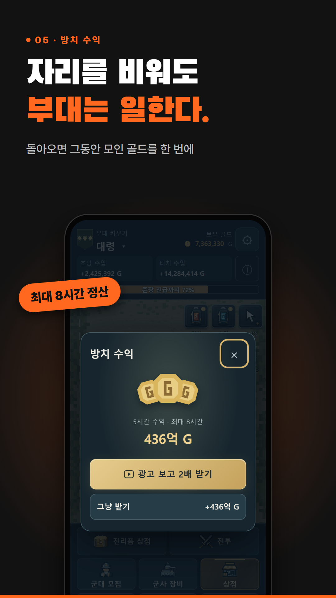</a>
<a href="promo/out/store-7.png">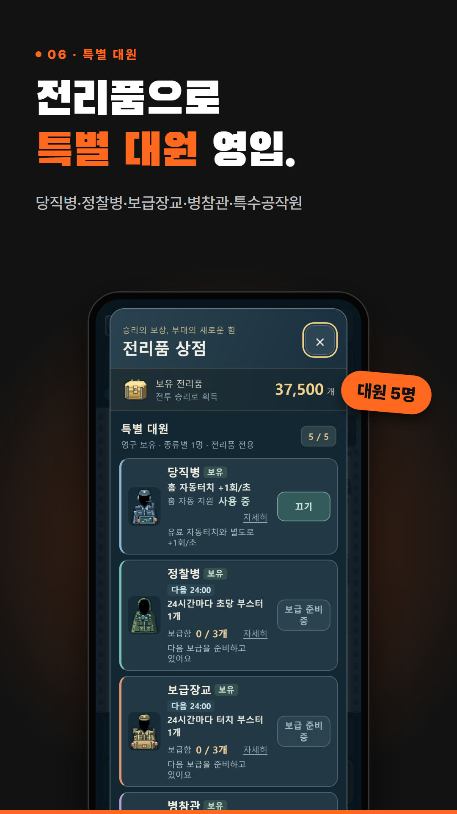</a>

<a href="promo/out/feature.png">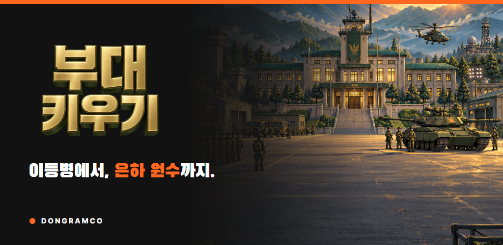</a>
<a href="promo/out/sns-numbers.png">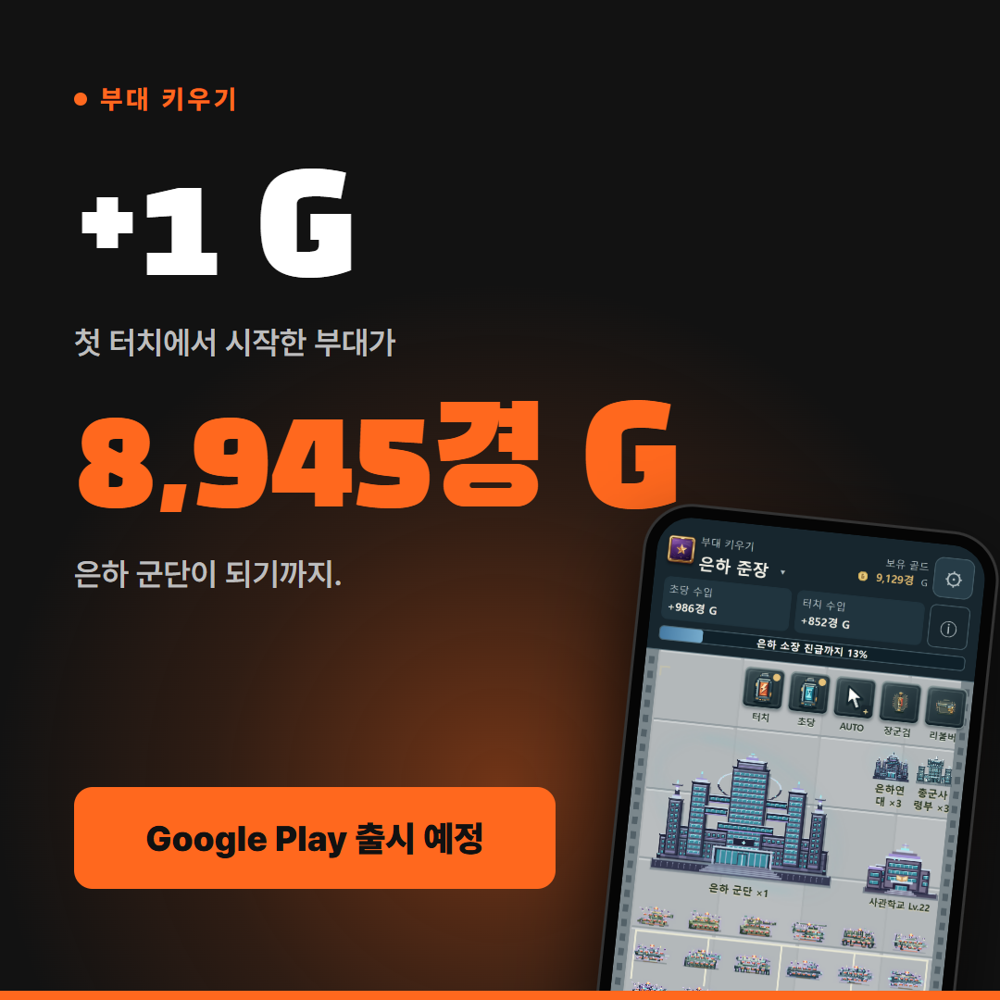</a>
<a href="promo/out/sns-promotion.png">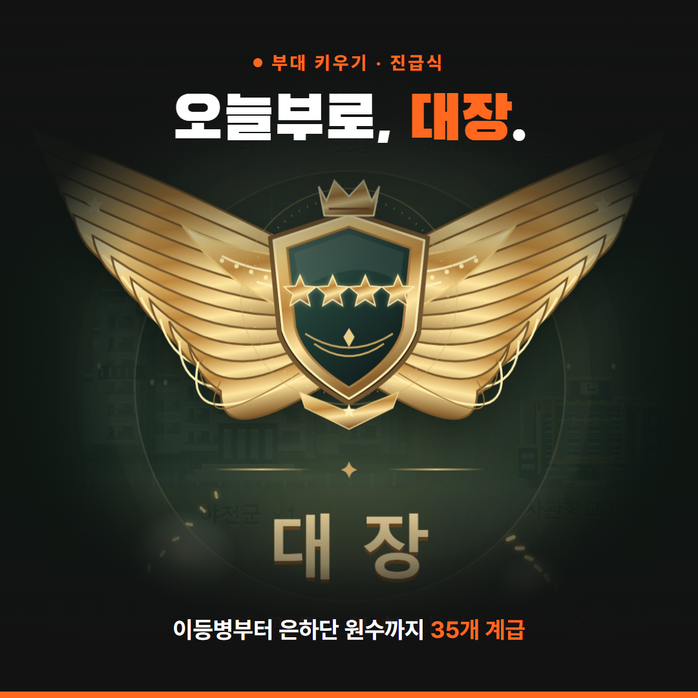</a>
<a href="promo/out/sns-cta.png">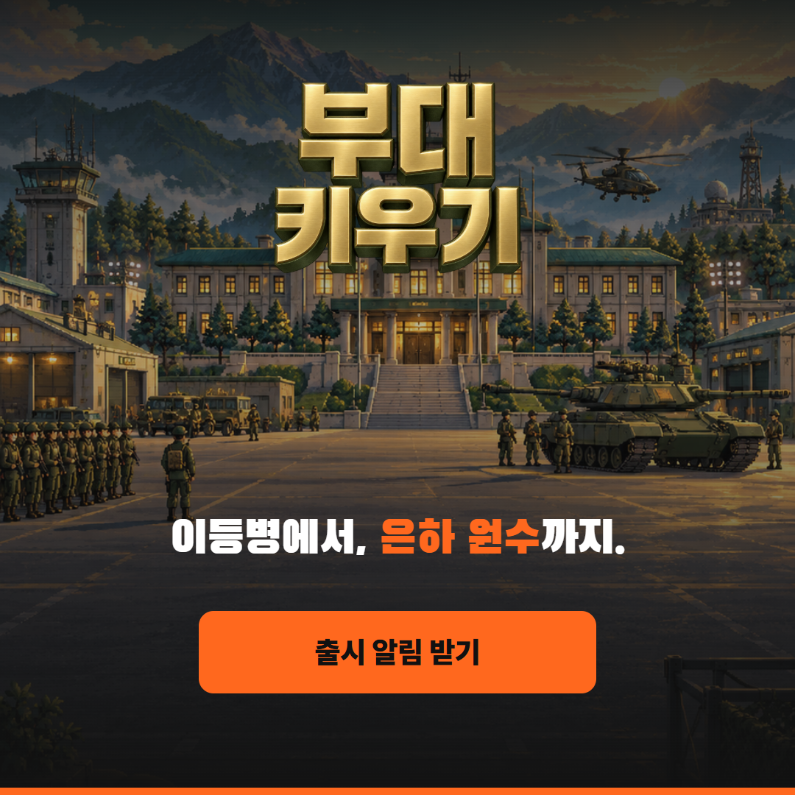</a>

| 파일 | 크기 | 용도 |
| --- | --- | --- |
| `store-1` ~ `store-7` | 1080×1920 | Google Play 스크린샷(전체 약속 → 핵심 재미 3 → 지속 동기 2) |
| `feature` | 1024×500 | Google Play 피처 그래픽 |
| `sns-numbers`, `sns-promotion`, `sns-cta` | 1080×1080 | 인스타그램 피드 |
| `story` | 1080×1920 | 인스타 스토리·릴스 커버 |

### 다시 만들기

1. `promo/creatives.html`에서 문구·배치를 고친다. 게임 그림은 `public/opening/`, `docs/store/assets/` 원본을 그대로 참조한다.
2. 이 폴더에서 실행: `npx -p puppeteer-core@23 node render.mjs` (일부만: `node render.mjs store-1,feature`)
3. `promo/out/`에 PNG가 다시 저장된다.

### 게임 화면 다시 찍기

`capture/`는 실제 게임을 별도 주소(127.0.0.1:4240)에서 열고, 테스트용 저장 데이터만 만들어 장면을 찍는다. 플레이어 실제 저장 기록(4173 등)은 건드리지 않는다.

1. 저장소 루트에서 `npx vite --host 127.0.0.1 --port 4240 --strictPort`
2. 다른 폴더에 `capture/*.mjs`를 복사하고 `npm i puppeteer-core@23` 후 `node homes.mjs`, `node scenes.mjs [early,mid,equip,road,battle,loot,promo,offline]`
3. 화면은 360×780 × 3배 = 1080×2340(AGENTS.md 보고 기준)으로 `shots/`에 저장된다. `webp.mjs <폴더> <최대폭>`으로 WebP 변환.

`fixtures.mjs`는 0.76.55 저장 형식 기준이다. 저장 버전이 오른 뒤(0.79.x는 저장 45)에는 검증 실패 시 필드를 맞춰야 한다.

## 동람코 홈페이지

- 주소: https://dongramco.com (www는 dongramco.com으로 301 이동)
- 호스팅: Cloudflare Pages 프로젝트 `dongramco` (2026-10-20 ChatGPT Sites에서 전환). 메일 MX·SPF·DKIM과 인증 TXT는 유지.
- 원본: `homepage/site/` (배포된 `dist`와 동일). 회사 PC의 작업 원본은 `sites/dongramco/dist`.
- 다시 배포: 원본 폴더에서 `npx wrangler@4 pages deploy dist --project-name dongramco --branch main`

| 페이지 | 내용 |
| --- | --- |
| `index.html` | 동람코 회사 소개 중심. 부대 키우기는 상단 '게임' 하위 메뉴와 제품 목록 한 줄로만 노출 |
| `games-budae.html` | 부대 키우기 소개(특징 6, 요금 안내, 미디어 키트, 고객지원) |
| `privacy.html` | 회사 홈페이지 개인정보 처리방침 초안(작성 예정) |

디자인은 로고의 두 모양을 모티프로 했다: 앞으로 나아가는 화살 엠블럼(점·구분자·히어로 그래픽·탭 아이콘), 세로획이 갈라진 D(카드 모서리·등장 효과). 효과는 헤더 축소, 스크롤 진행 막대, 스크롤 등장, 히어로 마우스 반응, 흐르는 띠이며 `prefers-reduced-motion`에서는 모두 끈다.

<a href="homepage/screens/v3-hero.webp">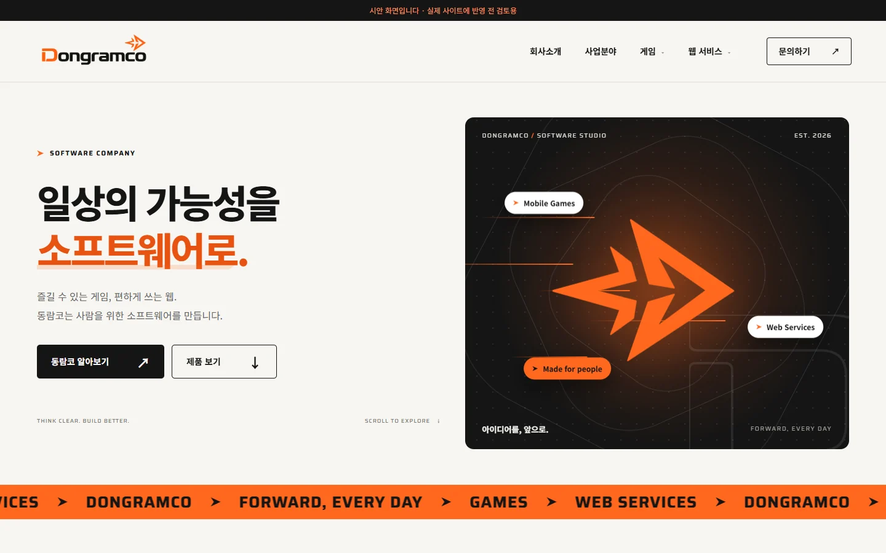</a>
<a href="homepage/screens/home-hover.webp">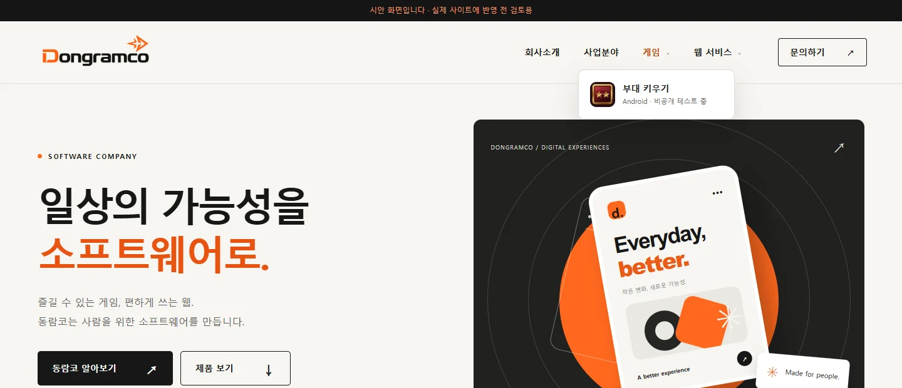</a>
<a href="homepage/screens/home-mobile-menu.webp">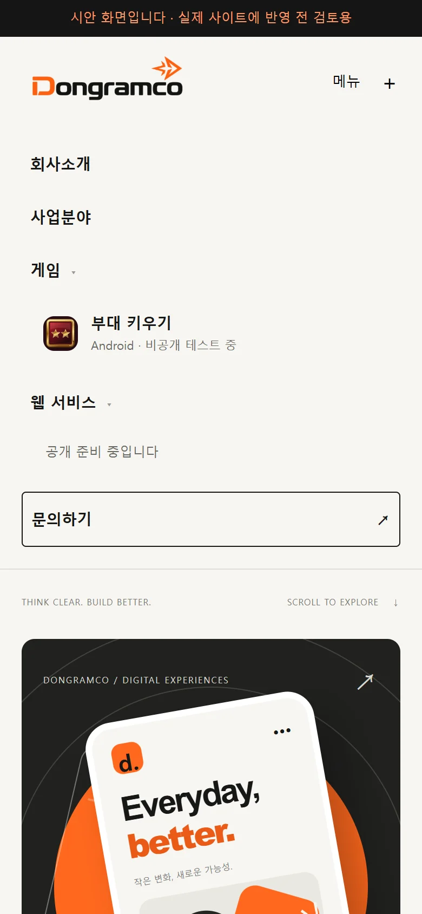</a>
<a href="homepage/screens/game-desktop.webp">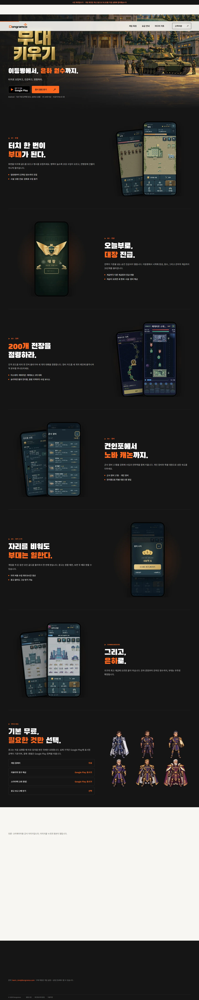</a>

회사정보는 사용자가 준 값만 공개했다: 상호 동람코(Dongramco), 대표자 김동환, 사업자등록번호 246-01-04216, 이메일 kevin_kim@dongramco.com. 주소·전화·통신판매업 신고번호는 넣지 않았다.

## 권리·출처

| 자산 | 출처·조건 |
| --- | --- |
| 게임 화면 | 이 저장소의 자체 게임을 실행해 캡처 |
| 타이틀 그림·레터링·앱 아이콘 | 저장소 기존 자산(`public/opening`, `docs/store/assets`). 출처는 기존 `docs/OPENING_ASSETS.md`, `ASSET_REGISTER.md` 기준 |
| Black Han Sans | SIL OFL 1.1(`public/fonts/black-han-sans/OFL.txt`) |
| Noto Sans KR, Saira | 홈페이지에서 Google Fonts로 불러옴, SIL OFL 1.1 |
| 동람코 로고·엠블럼 SVG | 회사 로고를 따라 그린 것. 상표 등록 여부는 확인하지 않음 |
| puppeteer-core, wrangler | 로컬 실행 도구. 게임·홈페이지 빌드에 포함되지 않음 |

## 확인하지 못한 것

- 홍보물의 실제 Play 콘솔 업로드, 광고 성과, 실기기 표시.
- 군사 장비 최대 강화 수치: 홍보물에는 숫자를 넣지 않았다(0.79.x는 Lv70으로 바뀜).
- 홈페이지 `noindex` 유지 중. 개인정보 처리방침 확정 후 해제 필요.
- 게임 소개 페이지의 개인정보처리방침·약관 링크는 공개 주소를 받지 못해 "게임 안 설정에서 확인" 문구로 대신함.
- 카카오톡 공유 미리보기 캐시 갱신.
